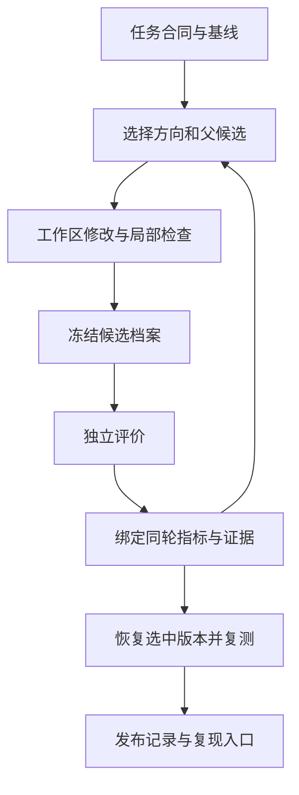

# 系统架构

RSIforme 把可恢复的研究状态放在 RSI-Harness 外层。v0.2 的持久 `ResearchController` 组织基线/profile、父代、worker、历史反馈、预算、恢复和确认；Archive 保存候选、执行身份与封存证据，delivery 导出可复查结果。Work/Judge 生命周期、容器和 Slurm 调度沿用 [RSI-Harness][harness]。

当前默认父代是 best-valid-search，固定研究线按配置轮转；worker 在该线内依据历史提出修改。自动 spawn 新线、合并获胜分支和自更新研究器尚未实现。scripted 控制器闭环已实际运行，真实模型两轮仍因审批阻断待验，见 [参考工程验收](REFERENCE_PARITY.md)。

## 一轮研究的交接

| 层 | 输入与输出 | 当前职责 |
| --- | --- | --- |
| 任务合同 | 代码范围、固定输入、硬件、计时范围、验收标准 | 固定可比较实验的条件 |
| 持久控制器 | 基线/profile、固定 lanes、父代、预算与历史 | 保存阶段，选择父代与当前线，调用 worker，交接反馈并决定停止/确认 |
| 候选档案 | 工作区中明确纳入的文件 | 保存完整文件内容与身份，支持恢复 |
| 执行与评价 | 冻结代码及任务定义 | 本地 CPU 示例；生产任务接 Harness |
| 评价登记 | 一次执行的状态、指标、日志与原始文件清单 | 区分成功、质量失败与环境错误，验证封存证据及补存附件 |
| 晋升与交付 | 选中候选及新的完整确认 | 校验 search/confirmation 因果关系，导出代码、证据与独立复查入口 |

## 身份与比较范围

`candidate_id` 指向一次候选及其父代；内容摘要识别精确源码。`harness_run_id` 来自 Harness 启动，`round_id` 标识该 run 内的提交。任务评价器自有的执行编号记为 `eval_run_id`。这些编号应分别保存；一次候选可以有多次评价。

比较前固定 task、评价器、数据、硬件和目标口径。目标从冷启动改为热推理、硬件从 H100 改为 A100，都会产生新的可比较集合。源码相同本身不足以复用旧成绩。

Harness 的 `best_rewards` 可能拼合不同提交的逐项最优值。必须沿 `best_round` 读取该轮 `report.json`，再把完整指标向量绑定到一个候选。[结果选择源码][aggregate]

## 持久化与恢复

提交顺序是“保存源码 → 发出提交 → 绑定返回轮次”。返回中断时保留待核对记录，查询同一 Harness run 的历史；重复提交会额外消耗预算。当前工作区可能比最好版本更新，交付时必须从候选档案恢复。[上游档案实现][artifacts]

研究评价和确认评价分别保留。确认需要新的执行身份、实际时间先后、指向准确 search 的 `confirmation_of`、相同源码/context 和完整验收；失败后保留证据，原发布继续有效。`research/` 保存单控制器阶段与 worker 进程身份，未决执行不会在重启后自动重发，显式放弃的未知评价仍消耗预算。具体转移见 [RESEARCH_LOOP](RESEARCH_LOOP.md)。

CPU 示例和两轮 scripted worker 已用真实进程演练这些交接；模型探索能力仍待验证。v0.1 与 v0.2 精确核心提交分别有成功的原生 Docker Work/Judge 记录；v0.2 还验证新增的执行证明、证据附件和独立发布校验。GPU/Slurm 未运行，真实 native timeout 注入也未验证。当前单控制器范围及后续能力见 [路线图](ROADMAP.md)。

[harness]: https://github.com/OpenRSI-Foundation/OpenRSI-Index/blob/486eec2b93296c514238f242f172703c3736ccc1/RSI-Harness/README.md
[aggregate]: https://github.com/OpenRSI-Foundation/OpenRSI-Index/blob/486eec2b93296c514238f242f172703c3736ccc1/RSI-Harness/src/rsi_harness/runtime/coordinator.py
[artifacts]: https://github.com/OpenRSI-Foundation/OpenRSI-Index/blob/486eec2b93296c514238f242f172703c3736ccc1/RSI-Harness/src/rsi_harness/runtime/artifacts.py
