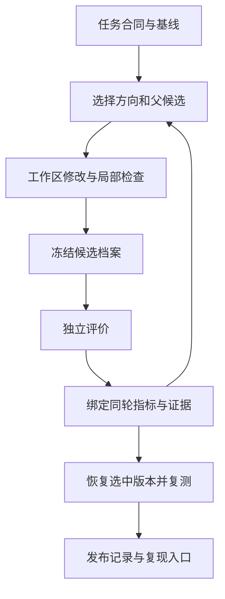

# 系统架构

RSIforme 把可恢复的研究状态放在 RSI-Harness 外层：保存候选、记录继承关系、关联评价、恢复选定版本并交付。Work/Judge 生命周期、容器和 Slurm 调度沿用 [RSI-Harness][harness]。方向选择目前由使用者或编码 Agent 承担。

## 一轮研究的交接

| 层 | 输入与输出 | 首版职责 |
| --- | --- | --- |
| 任务合同 | 代码范围、固定输入、硬件、计时范围、验收标准 | 固定可比较实验的条件 |
| 研究线 | 父候选、假设、预算、历史 | 表达一条有目的的探索路径 |
| 候选档案 | 工作区中明确纳入的文件 | 保存完整文件内容与身份，支持恢复 |
| 执行与评价 | 冻结代码及任务定义 | 本地 CPU 示例；生产任务接 Harness |
| 评价登记 | 一次执行的状态、指标、日志 | 区分成功、质量失败与环境错误 |
| 晋升 | 选中候选及完整复测 | 将交付绑定到准确代码和证据 |

## 身份与比较范围

`candidate_id` 指向一次候选及其父代；内容摘要识别精确源码。`harness_run_id` 来自 Harness 启动，`round_id` 标识该 run 内的提交。任务评价器自有的执行编号记为 `eval_run_id`。这些编号应分别保存；一次候选可以有多次评价。

比较前固定 task、评价器、数据、硬件和目标口径。目标从冷启动改为热推理、硬件从 H100 改为 A100，都会产生新的可比较集合。源码相同本身不足以复用旧成绩。

Harness 的 `best_rewards` 可能拼合不同提交的逐项最优值。必须沿 `best_round` 读取该轮 `report.json`，再把完整指标向量绑定到一个候选。[结果选择源码][aggregate]

## 持久化与恢复

提交顺序是“保存源码 → 发出提交 → 绑定返回轮次”。返回中断时保留待核对记录，查询同一 Harness run 的历史；重复提交会额外消耗预算。当前工作区可能比最好版本更新，交付时必须从候选档案恢复。[上游档案实现][artifacts]

研究评价和确认评价分别保留。确认需要完整验收、相同候选内容和可比较环境；失败后保留证据，原发布记录继续有效。CPU 示例用独立子进程演练这些交接，候选由预置文件提供。它不验证编码 Agent 的探索能力，也不构成 GPU 任务复现。首版采用单控制器；并发研究线和自动方向分配按 [路线图](ROADMAP.md) 接入。

[harness]: https://github.com/OpenRSI-Foundation/OpenRSI-Index/blob/486eec2b93296c514238f242f172703c3736ccc1/RSI-Harness/README.md
[aggregate]: https://github.com/OpenRSI-Foundation/OpenRSI-Index/blob/486eec2b93296c514238f242f172703c3736ccc1/RSI-Harness/src/rsi_harness/runtime/coordinator.py
[artifacts]: https://github.com/OpenRSI-Foundation/OpenRSI-Index/blob/486eec2b93296c514238f242f172703c3736ccc1/RSI-Harness/src/rsi_harness/runtime/artifacts.py
